<p align="center">
  
</p>

<h1 align="center">mdview</h1>

<p align="center">
  <strong>Lee archivos Markdown como páginas web — un visor y editor de 3 MB.</strong> Doble clic en cualquier archivo .md para abrirlo al instante, pulsa F2 para editar en el sitio.<br>
  Windows · macOS · Linux · Android &nbsp;|&nbsp; Hecho con Rust + WebView2, sin Electron
</p>

<p align="center">
  <a href="https://www.mdview.top/">Sitio web</a> ·
  <a href="https://github.com/mdview2026/mdview/releases/latest">Descargar</a> ·
  <a href="https://www.mdview.top/changelog.html">Novedades</a> ·
  <a href="https://www.mdview.top/blog/">Blog</a> ·
  <a href="docs/facts.md">Docs</a>
</p>

<p align="center">
  <a href="README.md">English</a> ·
  <a href="README.ja.md">日本語</a> ·
  <a href="README.es.md">Español</a> ·
  <a href="README.fr.md">Français</a>
</p>

---

La mayoría de las veces que abres un archivo `.md`, solo quieres **leerlo** — un README, unas notas, una respuesta generada por IA. Arrancar un editor completo para eso es matar moscas a cañonazos. mdview lo abre al instante como una página web, y cuando sí necesitas editar, `F2` te da WYSIWYG estilo Obsidian dentro de la misma ventana — sin cambiar a otra aplicación.

- **App diminuta.** Instalador de 3 MB, abre en menos de un segundo, cero configuración
- **Vista previa con pestañas (2.0).** Todos los documentos en una sola ventana — `Ctrl+Tab` para cambiar, con el desplazamiento y el estado de edición conservados
- **Cero ruido.** Lectura limpia a página completa — sin barras de herramientas ni paneles que no pediste
- **Edición en el sitio.** `F2` WYSIWYG estilo Obsidian, `F3` doble columna con vista previa en vivo
- **100% local** — sin cuenta, sin anuncios, tus archivos nunca salen de tu ordenador

<p align="center">
  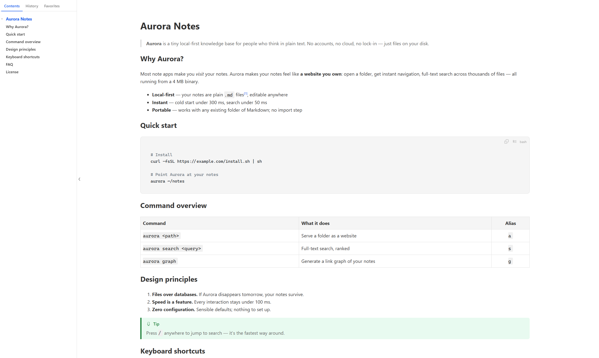
</p>

## Descargar

| Plataforma | Community (gratis para siempre) | Pro ($9.99 de por vida) |
|---|---|---|
| Windows 10/11 | [mdview-setup-en-latest.exe](https://github.com/mdview2026/mdview/releases/latest/download/mdview-setup-en-latest.exe) | [mdview-setup-pro-en-latest.exe](https://github.com/mdview2026/mdview/releases/latest/download/mdview-setup-pro-en-latest.exe) |
| macOS 11+ | [mdview-macos-en-latest.dmg](https://github.com/mdview2026/mdview/releases/latest/download/mdview-macos-en-latest.dmg) | [mdview-macos-pro-en-latest.dmg](https://github.com/mdview2026/mdview/releases/latest/download/mdview-macos-pro-en-latest.dmg) |
| Linux x86_64 | [mdview-linux-en-latest.tar.gz](https://www.mdview.top/download/mdview-linux-en-latest.tar.gz) | [mdview-linux-pro-en-latest.tar.gz](https://www.mdview.top/download/mdview-linux-pro-en-latest.tar.gz) |
| Android 7.0+ | [mdview.apk](https://www.mdview.top/download/mdview.apk) | — |

Ambas ediciones son el mismo producto y se sobrescriben entre sí al instalar — cambia cuando quieras. Android solo tiene edición Community.

> **¿Aviso de SmartScreen?** Windows marca las apps sin un costoso certificado de firma de código. Pulsa **Más información → Ejecutar de todas formas**. mdview funciona completamente en local y no sube nada.

## Por qué mdview

Haces doble clic en un `.md` para leerlo — no para arrancar un IDE. Piénsalo como el **Quick Look de Markdown**:

| | mdview | Typora / VS Code | Extensión de navegador |
|---|---|---|---|
| Tamaño de instalación | **3 MB** | 100–400 MB | — (pero necesita navegador) |
| Doble clic en un .md | **Instantáneo** | 3–5 s de arranque del editor | Arrastrar o copiar-pegar cada vez |
| Interfaz centrada en leer | **Cero adornos** | Barras, paneles, pestañas | El navegador alrededor |
| Pensado para | **Leer** | Escribir código / docs | Previsualizar de vez en cuando |

Se complementan — mantén tu editor para escribir y usa mdview para el 90% de las veces que solo lees.

## Novedades de la 2.0

### Vista previa con pestañas — todos los documentos, una sola ventana (Community y Pro)

Las especificaciones, las notas de API, las actas de reunión y los borradores de IA dejan de acumularse en la barra de tareas. Cada pestaña es su propio WebView, así que cambiar de pestaña nunca vuelve a renderizar — la posición de desplazamiento y el estado de edición F2/F3 se quedan exactamente donde los dejaste.

- `Ctrl+Tab` recorre las pestañas, `Alt+1–9` salta directamente a una; arrastra para reordenar, fija una pestaña o cierra en bloque
- Si haces doble clic en un archivo que ya está abierto, mdview activa su pestaña en lugar de abrir una segunda ventana
- Las pestañas, su orden y el estado de fijadas se restauran tras reiniciar; las pestañas en segundo plano no se pre-renderizan, así que el arranque en frío sigue siendo rápido

### Historial de versiones — un deshacer que sobrevive a la ventana (Pro)

mdview guarda una instantánea en cada guardado, cambio externo, entrada y salida del modo de edición y cierre de ventana. Explora la línea de tiempo, pon nombre a las versiones importantes, oculta el ruido, restaura con un clic y compara dos versiones cualesquiera en paralelo o en línea. El historial vive en un archivo SQLite local y nunca se sube.

## Características

### Vista previa

- **Doble clic para abrir** — el instalador asocia los archivos `.md` automáticamente; también `Ctrl+O`, arrastrar y soltar, y el menú contextual del Explorador
- **Refresco en vivo** — guarda en cualquier editor y la página se vuelve a renderizar al instante (push SSE), conservando tu posición de desplazamiento
- **Panel de esquema** — índice flotante con salto al hacer clic y sincronía de desplazamiento, más pestañas de **Historial** (agrupado por día), **Favoritos** y **Archivos** (explora los .md vecinos como un explorador de archivos)
- **Memoria de posición de lectura** — reabre donde lo dejaste; una sola ventana por archivo
- **9 temas de color + modo claro/oscuro** — Glacier, Forest, Sunset, Typewriter… un clic derecho para cambiar
- **Control tipográfico** — elige cualquier fuente instalada; `Ctrl+rueda` para el tamaño, `Alt+rueda` para el ancho de columna (reflujo real, no zoom de mapa de bits)
- **Atajos personalizables** — esquemas de teclas predefinidos para cambiar con un clic; casi cada acción se puede reasignar
- **Renderizado completo** — tablas con alineación, notas al pie con enlaces de retorno, imágenes locales, bloques de código con resaltado de sintaxis (copiar / ajustar línea / números de línea)
- **Exportar a PDF y a HTML de un solo archivo** (imágenes incrustadas, funciona sin conexión), interruptor de salto de línea simple, retroceso de codificación GBK/GB18030, comprobación automática de actualizaciones

<table>
  <tr>
    <td>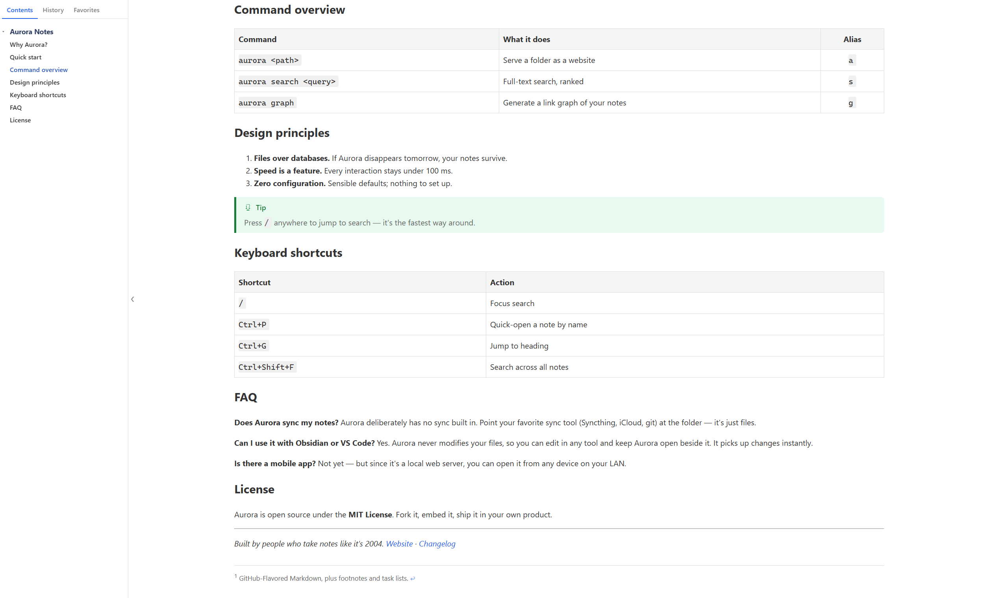</td>
    <td>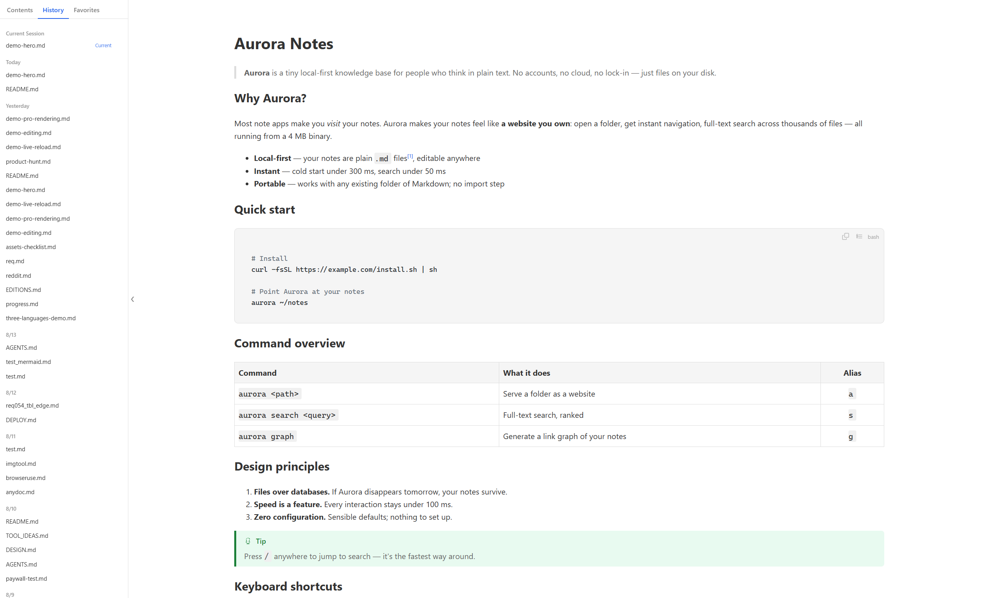</td>
  </tr>
  <tr>
    <td align="center"><sub>El esquema sigue tu desplazamiento</sub></td>
    <td align="center"><sub>Historial y favoritos, agrupados por día</sub></td>
  </tr>
</table>

**9 temas de color + modo oscuro**, un clic derecho para cambiar:

<table>
  <tr>
    <td>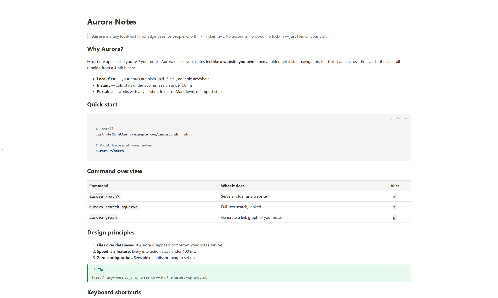</td>
    <td>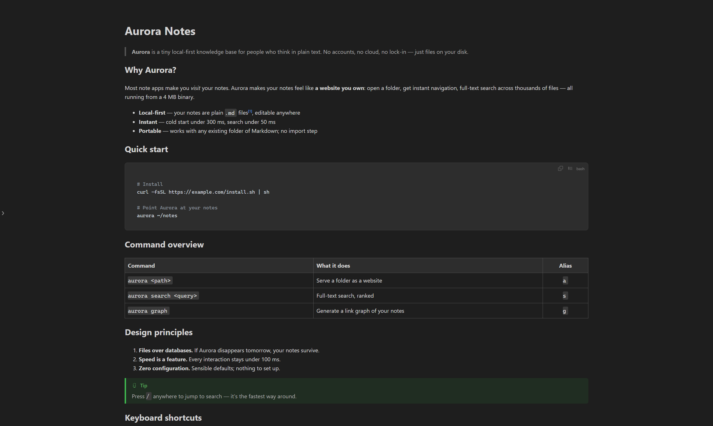</td>
    <td>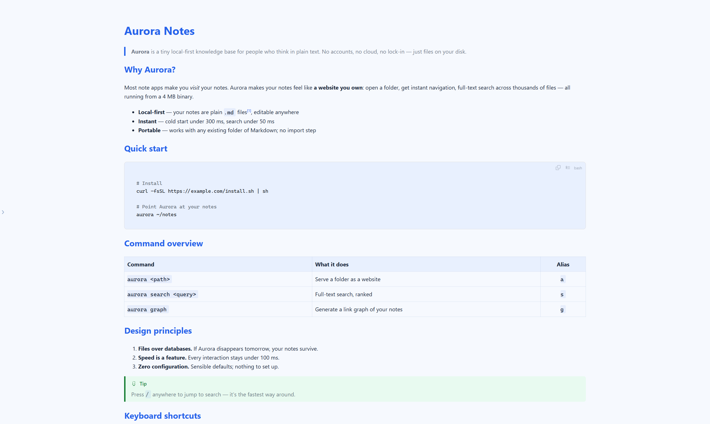</td>
    <td>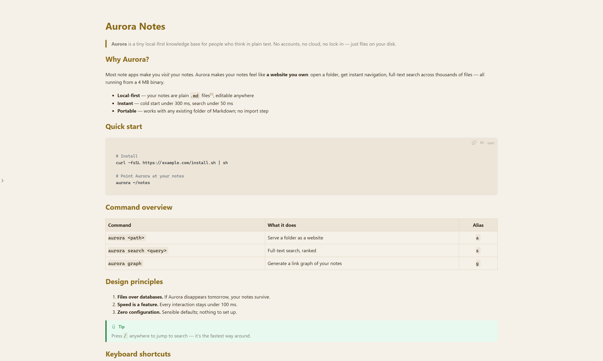</td>
  </tr>
  <tr>
    <td align="center"><sub>Default</sub></td>
    <td align="center"><sub>Dark</sub></td>
    <td align="center"><sub>Glacier</sub></td>
    <td align="center"><sub>Typewriter</sub></td>
  </tr>
  <tr>
    <td>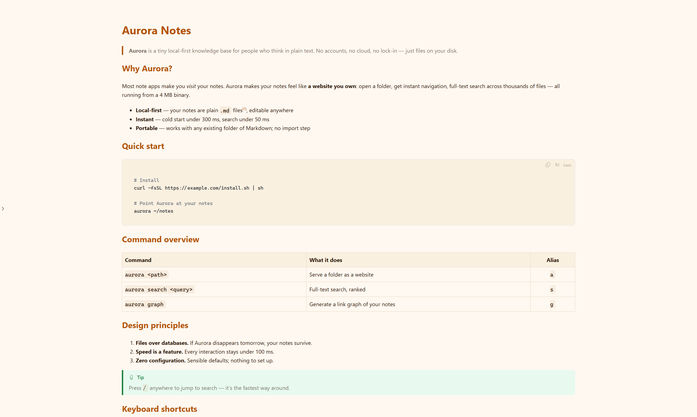</td>
    <td>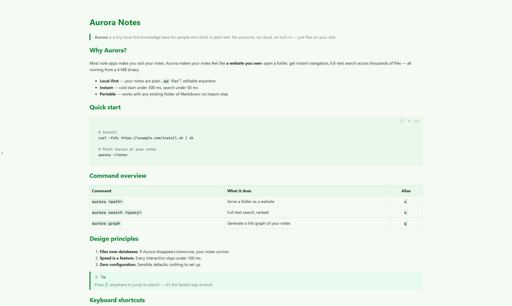</td>
    <td>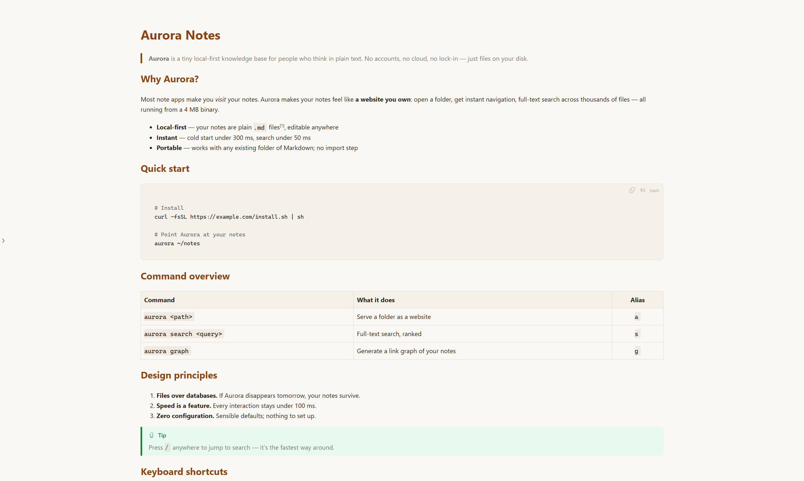</td>
    <td>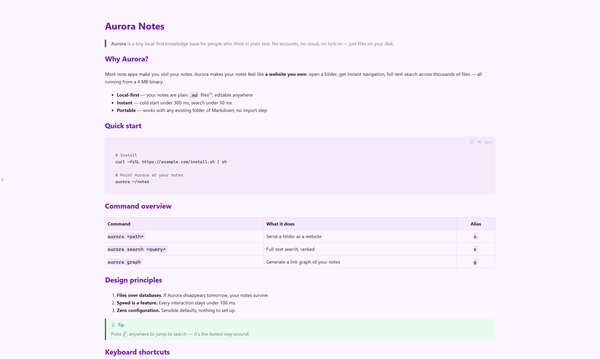</td>
  </tr>
  <tr>
    <td align="center"><sub>Sunset</sub></td>
    <td align="center"><sub>Forest</sub></td>
    <td align="center"><sub>Editorial</sub></td>
    <td align="center"><sub>Violet</sub></td>
  </tr>
  <tr>
    <td>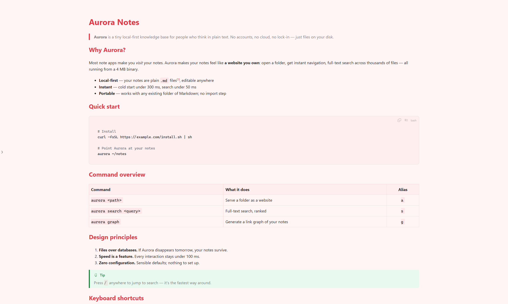</td>
    <td>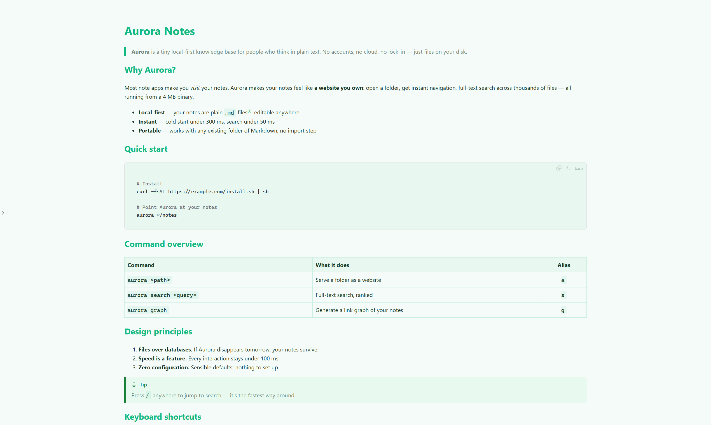</td>
    <td>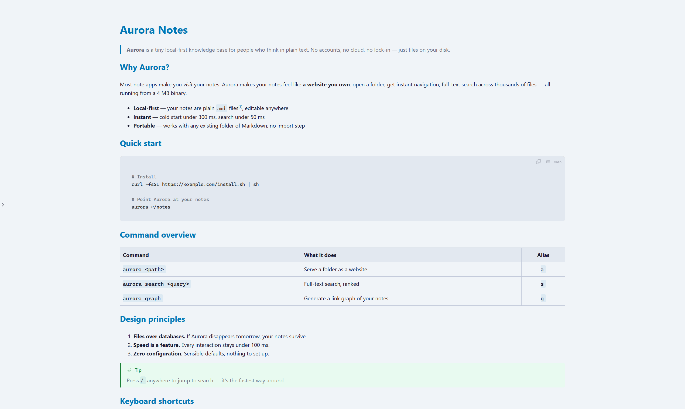</td>
    <td></td>
  </tr>
  <tr>
    <td align="center"><sub>Lychee</sub></td>
    <td align="center"><sub>Mint</sub></td>
    <td align="center"><sub>Neon</sub></td>
    <td></td>
  </tr>
</table>

### Edición

| Tecla | Modo | Edición |
|---|---|---|
| `F2` | **Edición en vivo** — WYSIWYG estilo Obsidian dentro de la vista previa: formato, enlaces, tablas (operaciones de filas/columnas), callouts | Pro |
| `F3` | **Edición en doble columna** — fuente a la izquierda, vista previa en vivo a la derecha, desplazamiento sincronizado por sección; `Tab` expande fragmentos; pegar una imagen/archivo lo guarda automáticamente en `.__assets/` e inserta el Markdown | Pro |
| `F4` / `Ctrl+E` | **Edición externa** — abre VS Code / Sublime / Notepad++ / Bloc de notas (detección automática) en la línea exacta del texto seleccionado | Gratis |
| `Esc` / `Ctrl+W` | Cerrar la ventana | Gratis |

<p align="center">
  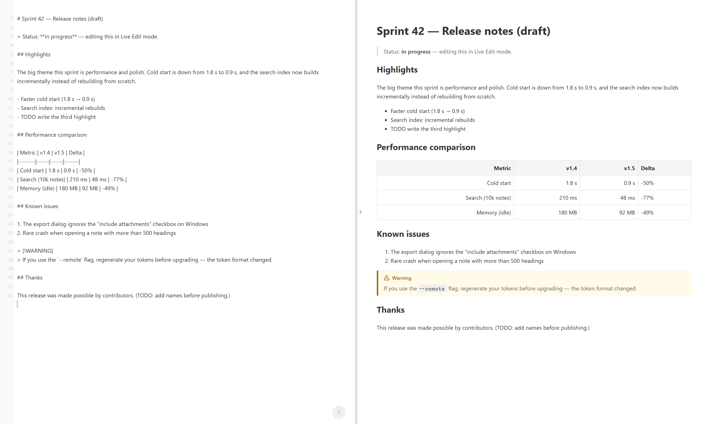
</p>

**Complementos de vista previa en vivo para Sublime Text y VS Code (Pro)** — la vista previa se actualiza mientras escribes, con sincronización bidireccional del cursor y la selección.

### Renderizado Pro

- **Diagramas Mermaid** (flujos / secuencia / Gantt) con visor a pantalla completa al hacer doble clic — zoom con rueda, arrastre para desplazar
- **Fórmulas matemáticas KaTeX** — LaTeX en línea `$...$` y en bloque `$$...$$`
- **Vista de mapa mental a pantalla completa** — clic derecho "Ver como mapa mental": los encabezados se convierten en ramas y las listas en hojas; rueda para ampliar, arrastra para desplazar, clic para contraer
- Los motores de renderizado se descargan una vez en el primer uso y luego funcionan totalmente sin conexión

<table>
  <tr>
    <td>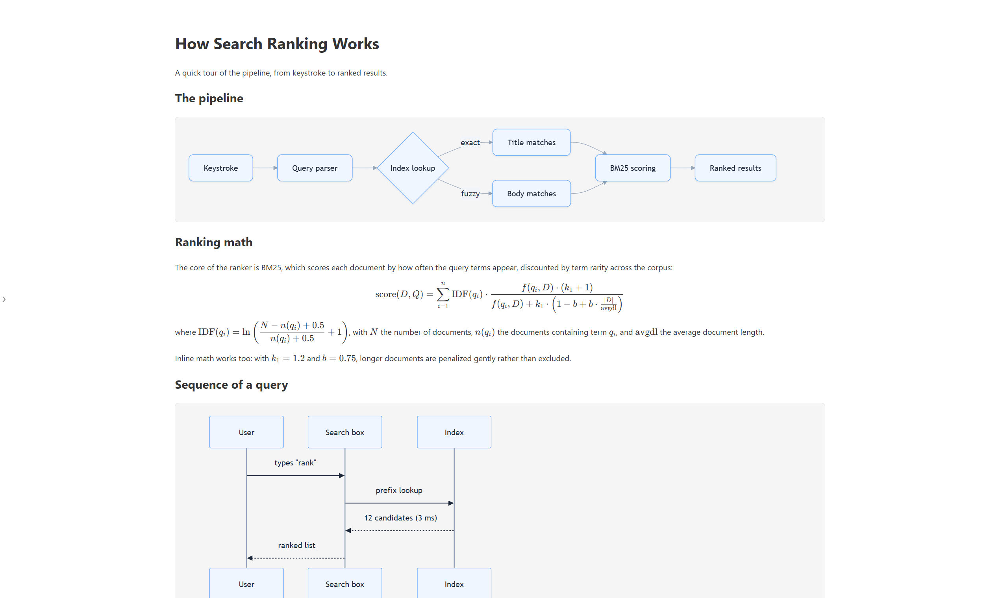</td>
    <td>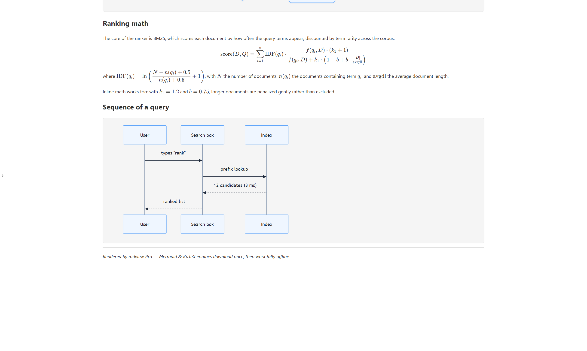</td>
  </tr>
  <tr>
    <td align="center"><sub>Diagramas Mermaid</sub></td>
    <td align="center"><sub>Matemáticas KaTeX</sub></td>
  </tr>
</table>

## Precio

| | Community | Pro |
|---|---|---|
| Precio | **Gratis para siempre** (patrocinio opcional) | **$9.99** desbloqueo único de por vida (Gumroad: tarjeta / PayPal) |
| Funciones de lectura básicas | ✅ todo | ✅ todo |
| Vista previa con pestañas (2.0) | ✅ | ✅ |
| Historial de versiones + diff | — | ✅ |
| Mermaid + KaTeX | — | ✅ |
| Edición en vivo (F2) + doble columna (F3) | — | ✅ |
| Prueba | — | 100 aperturas gratis, luego un aviso descartable de "Quizá más tarde" — **nunca se bloquea** |

## Primeros pasos

1. Descarga y ejecuta el instalador (o el `mdview.exe` portable)
2. Asocia automáticamente los archivos `.md` (desasocia cuando quieras: clic derecho → Configuración, o `mdview --unbind`)
3. Haz doble clic en cualquier archivo Markdown y lee

## Línea de comandos

```bash
mdview                     # ejecutar una vez: asocia los archivos .md
mdview <archivo.md>        # previsualizar un archivo concreto
mdview --install           # añadir "Abrir con mdview" al menú contextual del Explorador
mdview --uninstall         # quitar el menú contextual
mdview --settings          # ventana de ajustes (asociación, archivos recientes, editor)
mdview --unbind            # quitar la asociación predeterminada de .md
mdview --help              # ayuda
```

## Variables de entorno

| Variable | Descripción |
|---|---|
| `PORT` | Puerto del servidor HTTP (predeterminado: puerto libre aleatorio, alternativo 3456) |
| `MD_HTML=1` | Generar también un `.html` renderizado junto al archivo `.md` |
| `MD_HTML_OUTPUT=<ruta>` | Escribir el `.html` en una ruta concreta |
| `MD_EDITOR` | Comando del editor para `F4` (p. ej. `code --goto "{file}:{line}"`); detección automática si no se define |

## Preguntas frecuentes

<details>
<summary><strong>¿Cómo abro archivos .md en Windows?</strong></summary>

Instala mdview una vez y asociará los archivos `.md` por ti. A partir de entonces, haz doble clic en cualquier archivo Markdown y se abrirá renderizado como una página web — sin editor, sin extensión de navegador, sin configuración.
</details>

<details>
<summary><strong>¿Es gratis mdview?</strong></summary>

Sí. La edición Community es gratis para siempre con la experiencia de lectura completa, incluida la vista previa con pestañas añadida en la 2.0. La edición Pro añade historial de versiones integrado con diff, diagramas Mermaid, matemáticas KaTeX y dos modos de edición (F2 en vivo, F3 doble columna) por un único pago de $9.99 de por vida — primero tienes 100 aperturas de prueba gratis y después solo un aviso descartable de "Quizá más tarde". Nunca se bloquea.
</details>

<details>
<summary><strong>¿En qué se diferencia de Typora o VS Code?</strong></summary>

Typora y VS Code son editores — potentes, pero pesados cuando solo quieres leer. mdview es un visor dedicado: un instalador de 3 MB que abre en menos de un segundo y se cierra con `Esc`. Piénsalo como el Quick Look de Markdown. Se complementan entre sí.
</details>

<details>
<summary><strong>¿mdview sube mis archivos?</strong></summary>

No. mdview funciona 100% en local. Solo inicia un servidor temporal en `localhost` para renderizar la página — tu Markdown nunca sale de tu ordenador. Sin cuenta, sin anuncios, sin rastreo.
</details>

<details>
<summary><strong>¿Cuáles son los requisitos del sistema?</strong></summary>

Windows 10/11 con el runtime WebView2 (preinstalado en Windows 11 y en la mayoría de PCs con Windows 10) · macOS 11 Big Sur o posterior · Linux x86_64 (Ubuntu / Debian / Fedora / Arch; GTK3 + WebKitGTK) · Android 7.0 o posterior.
</details>

## Pila técnica

- **Lenguaje**: Rust (edición 2021)
- **GUI**: wry (WebView2) + tao
- **HTTP**: axum + tokio (solo localhost)
- **Markdown**: md4c embebido
- **Vigilancia de archivos**: notify + recarga en vivo SSE
- **Estilos**: Tailwind CSS

## Contacto

Dudas, informes de errores, licencias o cualquier otra consulta: **support@mdview.top**
